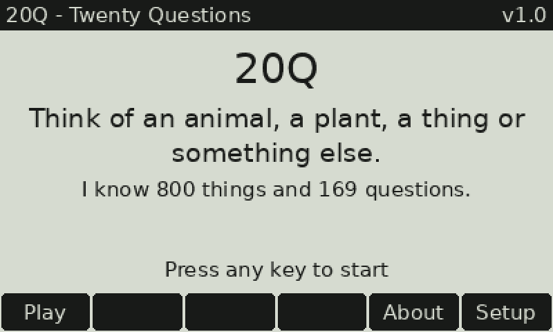

# 20Q til SwissMicros DM42 (DMCP 3.14+)



*Et rigtigt spil, spillet af spilmotoren og tegnet med `tools/make_gif.py`.*

Et "Twenty Questions"-spil i native C til DM42. Spillet er på engelsk og bygget mod DMCP 3.14-SDK'et, så det kører på **DMCP 3.16** og nyere.

Du tænker på noget, og lommeregneren gætter det. Den starter ligesom originalen med **"Animal, Vegetable, Thing or Other?"** og gætter efter højst 20 spørgsmål. Hvis den gætter forkert, får den op til 25. Den lærer af hvert spil.

**Startviden:** 800 ting (200 dyr, 200 planter, 200 menneskeskabte ting og 200 "andet": mad, steder, bygninger, vejr/rummet, materialer, kropsdele og personer/job) og 169 spørgsmål. Der er plads til 1.200 ting og 200 spørgsmål.

## Installation

1. Vælg **SETUP → Activate USB Disk**, og kopiér `20Q.pgm` til roden af disken.
2. Skub disken ud, og vælg **SETUP → System → Load Program → 20Q.pgm**.
3. Første gang bygger spillet sin vidensbase i `/20Q.DAT` (ca. 280 KB). Det tager et øjeblik.

Du kommer tilbage til lommeregneren ved at indlæse `DM42.pgm` igen (eller via **F6 Setup → System**).

## Taster

| Tast | Funktion |
|---|---|
| F1–F4 eller 1–4 | Første spørgsmål: Animal / Plant / Thing / Other (F5 = Unsure) |
| F1 / 1 | Yes |
| F2 / 2 | No |
| F3 / 3 | Maybe |
| F4 / 4 | Unknown |
| F5 / ← | Undo |
| F6 | Guess now |
| EXIT | Afbryd |

Hvis den ikke gætter det, vælger du det rigtige svar på listen (1–6), eller du trykker **0** og skriver det. Nye ting kan få et nyt spørgsmål med.

**Tekstindtastning:** Bogstaverne er dem, der står ved tasterne (Σ+ = A … x≷y = M … 3 = Z). **+** eller **0** giver mellemrum, **R/S** giver `?`, og **SHIFT** + en taltast giver et ciffer. F5 sletter, og F6 er OK.

Du nulstiller vidensbasen under **Setup → Reset knowledge base** eller ved at slette `/20Q.DAT`.

## Sådan virker det

Det er samme idé som originalen: en matrix med vægte (−8…+8) mellem hver ting og hvert spørgsmål.

- Hvert svar ændrer sandsynligheden for alle ting. Svaret på kategorispørgsmålet vejer tre gange så meget.
- Næste spørgsmål er det, der giver mest information (laveste forventede entropi).
- Efter spillet flyttes vægtene for den rigtige ting i retning af dine svar.

Matricen er for stor til RAM, så den ligger kolonnevis i `/20Q.DAT`. Hvert svar kræver én læsning, og der læses kun det område, hvor der stadig er kandidater (ca. 40 KB pr. spørgsmål). Programmet bruger ca. 28 KB heap.

**Testet på PC (simulering af alle 800 ting):**

| Svar | Gættet | Rigtigt i første gæt |
|---|---|---|
| Ærlige svar | 100 % | 99 % |
| 5 % forkerte svar | 99 % | 88 % |
| 10 % forkerte svar | 94 % | 71 % |

## Byg selv

Kræver `arm-none-eabi-gcc` (newlib) og `crc32` (`apt install gcc-arm-none-eabi libnewlib-arm-none-eabi libarchive-zip-perl`).

```
python3 tools/gen_kb.py   # data -> src/kb_default.h (tjekker også for ting der ligner hinanden)
make; make                # første kørsel skriver QSPI-headeren -> build/20Q.pgm
gcc -O2 -Isrc test/host_test.c src/q20.c -lm -o q20test && ./q20test
```

**Udvid startviden:** Tilføj linjer i `tools/data_*.py` (format `name | template | tokens`, hvor `x` = yes, `-x` = no og `~x` = unknown) eller nye spørgsmål i `tools/questions.py`. Kør derefter generatoren igen. Hvis spørgsmål eller ting ændres, laves `/20Q.DAT` ikke om automatisk. Brug **Reset knowledge base**.

## Filer

- `src/q20.c`, `src/q20.h`: spilmotoren (ren C, filbaseret)
- `src/main.c`: skærm, taster, tekstindtastning og fil-I/O (DMCP)
- `src/kb_default.h`: genereret, pakket startviden (2 bit pr. celle)
- `tools/`: spørgsmål, data for de fire kategorier og generatoren
- `test/host_test.c`: simulering på PC
- `tools/demo_game.c`, `tools/make_gif.py`: laver demo-GIF'en i `docs/`
- `dmcp/`, `bin/`, `stm32_program.ld`: fra SwissMicros SDKdemo, DMCP 3.14 (BSD-licens, se LICENSE)
